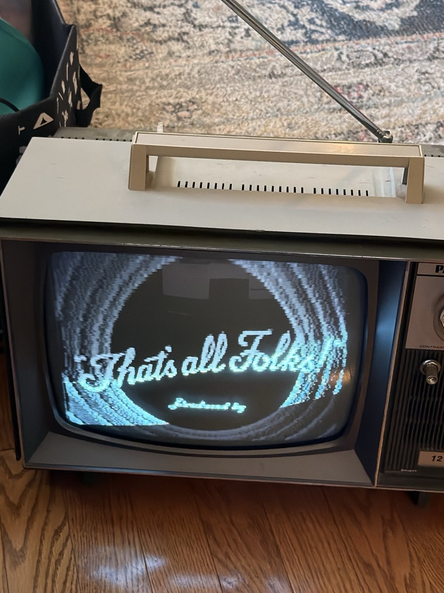

# rabbit-ears

<p align="center"></p>

An ESP32 that runs its own little TV station for a vintage black-and-white tube set, with **no extra parts**. Two short wires on two GPIO pins, held near the set's antenna screws, carry a watchable picture and FM sound on VHF channel 4. A Python station streams public-domain cartoons and creature features to it over Wi-Fi around the clock, and you run it from your phone with a web remote.

- 256×192 picture, 16 greys, 24 fps
- FM sound on its own carrier, 4.5 MHz above the picture, the way real NTSC does it
- Video and audio streamed over Wi-Fi (TCP, zlib-compressed frames) or USB
- A 24/7 "Channel 4" lineup run like an old station: a TV guide, Saturday-morning cartoons, vintage commercials between shows, Halloween and Christmas specials in season, and a sign-off with *O Canada* and the test pattern overnight, all from a LAN web page

The set it was built for has nothing on the back except 300 Ω VHF and UHF screw terminals. No composite input, no coax.

## ⚠️ Safety first: hot chassis

Many old tube sets have a **hot chassis**: one side of the mains is wired straight to the metal frame, and sometimes nearly straight to the antenna terminals. Touching them can kill you. Wiring your ESP32's ground to them can put mains voltage through your USB cable and into your computer.

So this project **never connects anything to the TV**. The wires on the ESP32 end in mid-air a few millimetres from the VHF screws, and the signal crosses that gap by radio. Keep it that way:

- Wires **near** the screws, **never touching** them. Insulated wire, and tape or a clip so they can't drift.
- Don't touch the screws or the chassis while the set is plugged in.
- Don't open the set. A tube TV holds lethal voltages inside, even after it's unplugged.

## Radio rules

This deliberately transmits on a broadcast TV channel. The signal from a few centimetres of wire is very weak and only meant to reach a set sitting right beside it. You are still responsible for following your country's rules for unlicensed low-power devices (FCC Part 15 in the US, ISED in Canada, and so on) and for not interfering with anyone else's reception. Keep the wires short, and turn it off when you aren't watching.

## How it works

A classic ESP32 can't output anything near 67 MHz directly. It can, however, stream a 1-bit pattern out of a pin very fast with I2S, clocked from its audio PLL. Square-ish pulses are rich in harmonics, and one of those harmonics is the transmitter.

```
I2S bit clock R = 27 Mbit/s (APLL, MCLK 54 MHz)

picture  D4  pulse on every 2nd bit  -> 13.5 MHz train -> 5th harmonic = 67.5 MHz  (ch 4 picture, 67.25)
sound    D5  pattern 100 100 100...  ->  9.0 MHz train -> 8th harmonic = 72.0 MHz  (exactly +4.5 MHz)
```

- **Picture.** NTSC uses negative AM: full carrier is sync, 75 % is black and 12.5 % is white. Dropping pulses from the 13.5 MHz train (first-order sigma-delta) sets the carrier strength, one 64 µs line at a time. The raster is NTSC-like, monochrome and non-interlaced: 262 lines at about 59.6 Hz. A random per-line dither each field turns sigma-delta's fixed stripe patterns into fine moving grain, and the eye averages the grain away.
- **Sound.** The set gets its audio from the 4.5 MHz beat between the picture and sound carriers. Without a sound carrier it buzzes with the picture. 27 MHz is the bit rate where an R/2 train and an R/3 train have harmonics exactly 4.5 MHz apart. FM (±25 kHz) shifts which bit the sound pulses land on, choosing every 4 words with the error noise-shaped away from the audio band. Audio is μ-law at 15 625 Hz, one sample per TV line, with 75 µs pre-emphasis.
- **Streaming.** Packets are framed by `A5 5A`. Each one is a 4-bit 256×192 picture (zlib-compressed over Wi-Fi) plus that frame's share of the audio, so picture and sound can't drift apart. The board inflates frames with the inflater already in the ESP32's ROM. Over Wi-Fi, TCP flow control paces the sender, and a new connection takes over the TV.
- **Two cores.** One core builds the picture, line by line, from a per-pixel lookup table. The other generates the sound and runs the network.

The big comment at the top of [`rf-video/rf-video.ino`](rf-video/rf-video.ino) has the full design, including the dead ends: a 40 MHz LEDC carrier was too weak, a 40.5 MHz APLL clock boot-loops, and a 6-phase noise-shaped FM looked great in simulation and sounded garbled on the real set.

## What you need

- An **ESP32** dev board: a classic ESP32 (tested on a DevKit V1), or an **ESP32-S3 with PSRAM** (tested on a Freenove ESP32-S3 N16R8), which is the better choice. See [the S3](#the-esp32-s3).
- Two short insulated jumper wires, one on **D4** (GPIO4, picture) and one on **D5** (GPIO5, sound).
- An analog TV that can tune VHF channel 4. That means an old set; anything digital-only won't see it.
- [Arduino CLI](https://arduino.github.io/arduino-cli/) or the Arduino IDE with the **esp32 core 3.x** (built with 3.3.0).
- For streaming: Python 3, `ffmpeg`, and Pillow (`pip install pillow`). Add `pyserial` for USB.

## Getting a picture

Start with the zero-effort tests, in this order:

1. **[`rf-test/`](rf-test/rf-test.ino)** switches a bare carrier on and off 120 times a second. Tune to channel 4 and you should see two wide black bands with snow between them, drifting slowly (there's no sync yet to hold them still). That proves the RF path.
2. **[`rf-tv/`](rf-tv/rf-tv.ino)** shows a still test card with a silent sound carrier, so the buzz goes quiet. Use it to set the fine tuning, then the antenna wires' position, for the cleanest picture. `python3 tools/make_image.py photo.jpg` swaps in your own picture.
3. **[`rf-video/`](rf-video/rf-video.ino)** is the real station firmware.

```sh
cp rf-video/wifi_secrets.example.h rf-video/wifi_secrets.h   # then fill in your Wi-Fi
arduino-cli compile --fqbn esp32:esp32:esp32 rf-video
arduino-cli upload  --fqbn esp32:esp32:esp32 -p /dev/cu.usbserial-0001 rf-video
```

The board joins your Wi-Fi as `tubetv.local` and listens on TCP port 5000.

With `OTA_PASSWORD` set in `wifi_secrets.h`, later updates go over Wi-Fi: `sh tools/ota.sh` builds and pushes from the station box, pausing Channel 4 for about a minute. Put the board's FQBN in `deploy/fqbn` (one line) if it isn't a classic ESP32.

### The ESP32-S3

The S3 has no APLL, so there's no 27 MHz bit clock, and no whole-number division of its 160 MHz PLL puts two pulse trains' harmonics 4.5 MHz apart. The firmware works around that when it's built for an S3:

- **Picture:** R = 160 MHz / 6 = 26.667 Mbit/s exactly. A pulse every other bit is a 13.333 MHz train; its 5th harmonic, 66.667 MHz, sits 0.6 MHz under channel 4's picture carrier, within the fine tuning. Lines are 53 words (63.6 us), 60.01 Hz.
- **Sound** has to be 71.1667 MHz. The 3-bit pattern's 8th harmonic is 71.111 MHz, so the per-word FM carries a +55.6 kHz offset: the quiet carrier steps 120 degrees every 5 words, a 15-word cycle whose strongest line is exactly 71.1667 MHz. [`rf-s3/`](rf-s3/rf-s3.ino) is the test card for it: quiet with the carrier on, a buzz with it off, and a hiss with it stepped the wrong way.
- **The picture is 288x216** (256x192 on the classic): one row per visible line, square pixels. Tell the station with `CHANNEL4_SIZE=288x216` (the board reports its size in `#status`, and the station warns if they differ).
- **Frames live in PSRAM**, eight of them, and there's ~170 KB of internal RAM to spare (the classic runs at ~49 KB, close to where Wi-Fi gives up). It keeps up at 30 fps; the classic manages about 88% of real time there.
- Audio is one sample per line, so on the S3 everything plays 0.6% fast. Nobody hears it.

```sh
arduino-cli compile --fqbn esp32:esp32:esp32s3:PSRAM=opi,FlashSize=16M,PartitionScheme=app3M_fat9M_16MB rf-video
```

Use GPIO4 (picture) and GPIO5 (sound), as on the classic.

## Playing something

```sh
python3 tools/play.py some-film.mp4            # over Wi-Fi to tubetv.local
python3 tools/play.py some-film.mp4 60 30      # start at 60 s, play 30 s
python3 tools/play.py test                     # moving test pattern + a tune
```

The flags are `--host=`, `--fps=`, `--sound=`, `--cleanup=strong|light|off`, `--no-dither` and `--usb` (with `--serial=/dev/ttyUSB0` or `COM3` off the Mac). USB only manages about 3 fps at this resolution, so it's mostly for testing.

## Channel 4: the station

```sh
python3 tools/station.py --port=8080           # then open http://localhost:8080 (port 80, the default, needs root)
```

[`tools/station.py`](tools/station.py) plays the lineup nonstop:

- The **day** block is shuffled, and the **night** block runs from 21:00 to 06:00 in the box's own time zone (containers often default to UTC, so set it). The lineup is seeded from [`tools/lineup.json`](tools/lineup.json).
- It **plans a few hours ahead**, drawing each show for the time it will start: weekend mornings are cartoons only, and features wait for the afternoon. Each show is a cartoon, short or feature (guessed from its length and title, or set by hand).
- Shows tagged **Halloween** or **Christmas** only play in season, and twice as often then.
- **Commercial breaks:** "we'll be right back", then one or two vintage spots from the commercials list.
- **Broadcast day:** at sign-off it plays *O Canada* (the Columbia Mixed Quartette, 1913) over the flag, holds the test pattern until sign-on, and plays it again in the morning.
- Each show is fetched once from archive.org, shrunk to 256 px, and kept in `cache/`. Black bars baked into a file are cut off, and a picture that's nearly 4:3 fills the screen.
- Pictures go out with a 4x4 ordered dither down to the board's 16 greys, and each show at its own frame rate (24 for film, 30 for TV transfers), capped by the setting. Keep the cap at 24: at 256x192 the board falls behind at 30.
- An "up next" card plays before each show. If the station restarts, it picks up where it left off.

The web page ([`tools/web/index.html`](tools/web/index.html)) is built for a phone:

- **Now:** a live thumbnail, the remote (skip, mute, volume, stand by, test pattern, sign off), the play-next queue and what's coming up.
- **Guide:** the next 18 hours with estimated times.
- **Lineup:** daytime, late night and commercials, with archive.org search, and each show's kind and season.
- **Downloads:** what's cached, its size, and the space left.
- **Settings:** picture and sound (including **sound cleanup**: click removal and denoising before the compressor, which brings the hiss in the pauses down about 27 dB without touching dialogue), the schedule, and the health of the link to the TV. With firmware that answers command `S`, the board reports its uptime, why it last restarted, free memory, signal and load every 30 seconds.

There is **no sign-in**, so keep it on your LAN. The station refuses commands sent by other web pages (a foreign `Origin`, or a body that isn't JSON), but anyone on your network can use the remote.

To run the station around the clock on a small Linux box or container, use [`deploy/`](deploy/). It's a systemd unit with a dynamic user and state in `/var/lib/channel4`:

```sh
sh deploy/push.sh root@your-box
```

The box needs `python3`, `python3-pil`, `ffmpeg`, `fonts-dejavu-core`, `avahi-daemon` and `libnss-mdns`, plus its time zone set (`timedatectl set-timezone America/Toronto`). The script deploys the committed `tools/` as of `HEAD`, as root.

The shows in the default lineup are films generally treated as public domain in the US: classic Fleischer Superman and Popeye, early Bugs Bunny, Three Stooges shorts, *Steamboat Willie*, *Nosferatu*, *Night of the Living Dead* and *Carnival of Souls*. The repo only holds their archive.org identifiers. Check the status where you live before rebroadcasting anything. Some of the cartoons are of their time.

## Repo map

| Path | What |
|---|---|
| `rf-test/` | First RF smoke test: a 13.33 MHz LEDC carrier, 5th harmonic near channel 4 |
| `rf-tv/` | Still test card plus silent sound carrier; `picture.h` is made by `tools/make_image.py` |
| `rf-s3/` | The test card on an ESP32-S3: 66.667 MHz picture, stepped sound carrier |
| `rf-video/` | The station firmware (classic ESP32 or S3): streamed video and FM sound |
| `i2s-selftest/` | Bench check of the I2S bit order on the wire |
| `tools/tvlink.py` | Shared streaming code: ffmpeg decode, packing, audio filters, the Wi-Fi link |
| `tools/play.py` | Stream one file by hand |
| `tools/station.py`, `tools/web/` | The Channel 4 station and its web remote |
| `tools/tv.py` | Serial tuning for `rf-tv` (`python3 tools/tv.py d0.2`) |
| `tools/look.sh` | macOS camera and mic capture, to check the TV's picture and sound from a script |
| `tools/ota.sh` | Over-the-air firmware update, pushed from the station box |
| `deploy/` | systemd unit and push script |

## Limits

It's a party trick that turned out to be watchable, not a broadcast-grade modulator:

- The picture has fine grain.
- The raster is 262-line non-interlaced, and black and white only.
- Sound is clean but limited to roughly 7 kHz.

For a better picture, put a cheap RF modulator between the TV and a real composite source. That would be the ESP32's DAC, or a Raspberry Pi's composite out.

## License

MIT. See [LICENSE](LICENSE).
